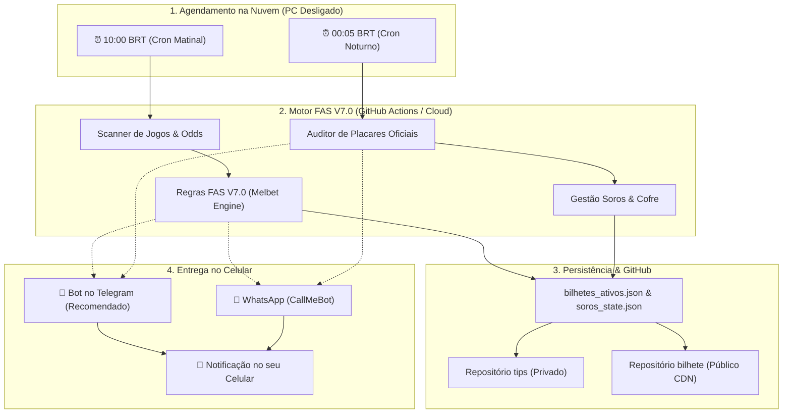
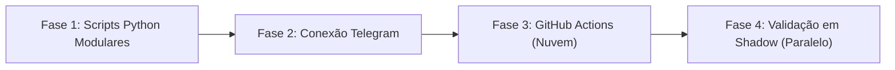

# 🏛️ PLANO DE ARQUITETURA: AUTOMAÇÃO & NOTIFICAÇÕES DO FAS V7.0

Este documento estrutura a arquitetura completa para transformar o **Football Analysis System (FAS V7.0 Melbet Engine)** em uma operação 100% autônoma, capaz de rodar na nuvem (mesmo com seu computador desligado) e entregar as entradas e o confere prontos no seu celular.

---

## 🎯 OBJETIVO DO SISTEMA

Eliminar a necessidade de intervenção humana diária para as duas rotinas fundamentais:
1. **09:30 - 10:00 BRT (FAS Matinal):** Varrer a rodada, montar os bilhetes inteligentes com a Metodologia V7, atualizar o Desafio Soros, sincronizar os repositórios e disparar a grade formatada no seu mensageiro.
2. **00:05 - 00:30 BRT (FAS Confere):** Auditar os placares fáticos de todas as partidas, auditar perna por perna, liquidar o balanço financeiro, atualizar o cofre do Soros e enviar o relatório de lucros/ROI no seu mensageiro.

---

## 🔄 DIAGRAMA DE FLUXO GERAL (END-TO-END)



---

## 🧱 OS 4 PILARES DA ARQUITETURA

### PILAR 1: Infraestrutura de Execução (Onde Roda)

Para que você não precise deixar o computador ligado ou se preocupar com energia e internet de casa, avaliamos 3 abordagens:

| Abordagem | Funciona com PC Desligado? | Custo | Confiabilidade | Complexidade de Manutenção |
| :--- | :---: | :---: | :---: | :---: |
| **A) GitHub Actions (Recomendado)** | ✅ **Sim (100% Nuvem)** | **R$ 0,00** (Gratuito no GitHub) | ⭐⭐⭐⭐⭐ (Servidores Microsoft) | Baixa (arquivo YAML versionado no próprio repositório) |
| **B) Servidor VPS Dedicado (Linux)** | ✅ **Sim (100% Nuvem)** | ~R$ 25 a R$ 40/mês | ⭐⭐⭐⭐⭐ | Média (precisa gerenciar Linux, SSH, atualizações) |
| **C) Automação Local (PC Pessoal)** | ❌ **Não (PC precisa ficar ligado)** | R$ 0,00 | ⭐⭐ (Falha se PC dormir ou desligar) | Baixa |

> [!IMPORTANT]
> **Decisão Recomendada:** **GitHub Actions**. Ele já está integrado aos seus repositórios (`iadecria/tips` e `iadecria/bilhete`), tem cron nativo, suporte a Python, segredos criptografados e não gasta 1 centavo.

---

### PILAR 2: Motor de Decisão & Inteligência

O motor precisa ser determinístico e blindado para evitar alucinações de odds ou escolhas frágeis:

1. **Geração Matinal (`generate_fas.py`):**
   * Puxa a lista de jogos oficiais do dia (grandes ligas da Europa, UWCL, Brasileirão, Copas).
   * Filtra jogos com liquidez na Melbet.
   * Aplica estritamente a **Metodologia FAS V7.0**:
     - *Bilhete Supremo:* Trinca técnica dos turnos (@3.15 a @3.80).
     - *SAFE Enxuta:* Stop 1 cobrindo os secundários; Stop 2 blindado com DNB (Empate Anula).
     - *Super Ataque:* Foco em Mais de 2.5 Gols e totais individuais (sem armadilhas de BTTS em zebras).
     - *Múltipla 5:* Estruturada para o modo Sistema 6/8 da Melbet.
     - *Desafio Soros:* Entrada diária conservadora (@1.40 a @1.55) com travas de segurança de cofre nos Dias 5 e 7.

2. **Auditoria Noturna (`confere_fas.py`):**
   * Lê `bilhetes_ativos.json`.
   * Puxa os placares finais e tempos de gol das partidas auditadas.
   * Valida cada perna (HIT, MISS, VOID/Reembolso).
   * Calcula o lucro líquido baseado na sua unidade padrão ou no valor padrão de R$ 15,00.
   * Avança o dia do Desafio Soros em caso de Green ou aciona a regra de reinício de ciclo em caso de Red.

---

### PILAR 3: Persistência & Sincronização

Garante integridade histórica para backtests futuros e disponibilização pública:

* **Repositório Privado (`iadecria/tips`):** Guarda os códigos fonte, os relatórios completos `.md` e os arquivos de histórico detalhado.
* **Repositório Público (`iadecria/bilhete`):** Espelha os arquivos `bilhetes_ativos.json`, `soros_state.json` e o `simulador_unidades.html`, permitindo que você consulte em qualquer dispositivo através de endpoints CDN limpos (Raw GitHub).

---

### PILAR 4: Camada de Notificação no Celular (Telegram vs. WhatsApp)

Como as informações chegarão até você:

```
┌──────────────────────────────────────────────┐
│ 🌅 FAS V7.0 — GRADE DO DIA (20/11)          │
│ 🎯 Foco: Melbet Engine Edition               │
├──────────────────────────────────────────────┤
│ ⭐ SUPREMO V7 (@3.24) — Stake R$ 3,00        │
│ • Bayern -1.5 AH (@1.42)                     │
│ • Athletic Bilbao ML (@1.52)                 │
│ • Arminia x Magdeburg Over 1.5 (@1.20)       │
│ • Troyes 1X (@1.25)                          │
├──────────────────────────────────────────────┤
│ 🟢 SAFE V7 (Stop 2 com DNB @2.56)           │
│ • Saída Recomendada: R$ 38,40 (+R$ 23,40)    │
├──────────────────────────────────────────────┤
│ 🔥 SOROS DIA 6 DE 30 (@1.44)                │
│ • Stake: R$ 55,58 (Risco Zero!)              │
│ • Retorno: R$ 80,03                          │
└──────────────────────────────────────────────┘
```

#### Comparativo de Mensageiros:

* **Telegram Bot:**
  * **Vantagens:** 100% gratuito, sem limite de caracteres, formatação rica (Markdown com negrito, itálico, listas, links diretos para a Melbet), entrega garantida em microssegundos, zero risco de banimento de número.
  * **Configuração:** 1 bot criado no `@BotFather` + 1 Chat ID (seu usuário ou um canal privado criado por você).
* **WhatsApp:**
  * **Vantagens:** Mensageiro que você já usa no dia a dia.
  * **Desvantagens:** APIs oficiais exigem verificação e custos por mensagem; soluções gratuitas como CallMeBot cortam mensagens muito longas e podem sofrer instabilidade temporária.

---

## 🛡️ TRATAMENTO DE CASOS DE BORDA (EDGE CASES)

Um sistema profissional precisa saber lidar com imprevistos sem quebrar:

1. **Jogos Adiados / Cancelados:** Na Melbet, seleções canceladas recebem Odd @1.00 (reembolso da perna). O script do Confere precisa computar a anulação da perna e recalcular a odd do bilhete sem marcar como Red.
2. **Dias Sem Jogos Relevantes (Data FIFA / Férias):** Se a grade tiver menos de 4 jogos elegíveis dentro dos critérios de segurança do FAS, o sistema envia uma mensagem de *"Dia de Preservação de Banca (No-Bet Day)"*, mantendo o capital seguro.
3. **Jogos que Terminam Após a Meia-Noite:** Partidas da CONMEBOL (Libertadores/Sul-Americana) ou da MLS que terminam às 01:00 BRT. O Confere pode ser configurado com uma janela de checagem ou tolerância para só liquidar após o apito final dessas partidas.
4. **Flutuação Severa de Odds:** Se uma odd cair abaixo da margem mínima aceitável, o gerador descarta a seleção e busca a alternativa secundária mapeada.

---

## 🗺️ ROTEIRO DE IMPLEMENTAÇÃO PROPOSTO



* **Fase 1 (Scripts Autônomos):** Criar `futebol/fas_engine.py` e `futebol/confere_engine.py` para executar todo o raciocínio via terminal sem depender de chat aberto.
* **Fase 2 (Bot de Notificação):** Criar o módulo `notifier.py` com suporte ao Telegram (e WhatsApp opcional) formatando as mensagens de forma compacta e elegante.
* **Fase 3 (Automação na Nuvem):** Escrever o workflow do GitHub Actions (`.github/workflows/fas_automation.yml`) agendando as execuções para rodar nos servidores da nuvem com seu PC desligado.
* **Fase 4 (Teste em Shadow):** Rodar 2 a 3 dias em modo assistido para validar a precisão dos alertas antes de deixar 100% desassistido.
